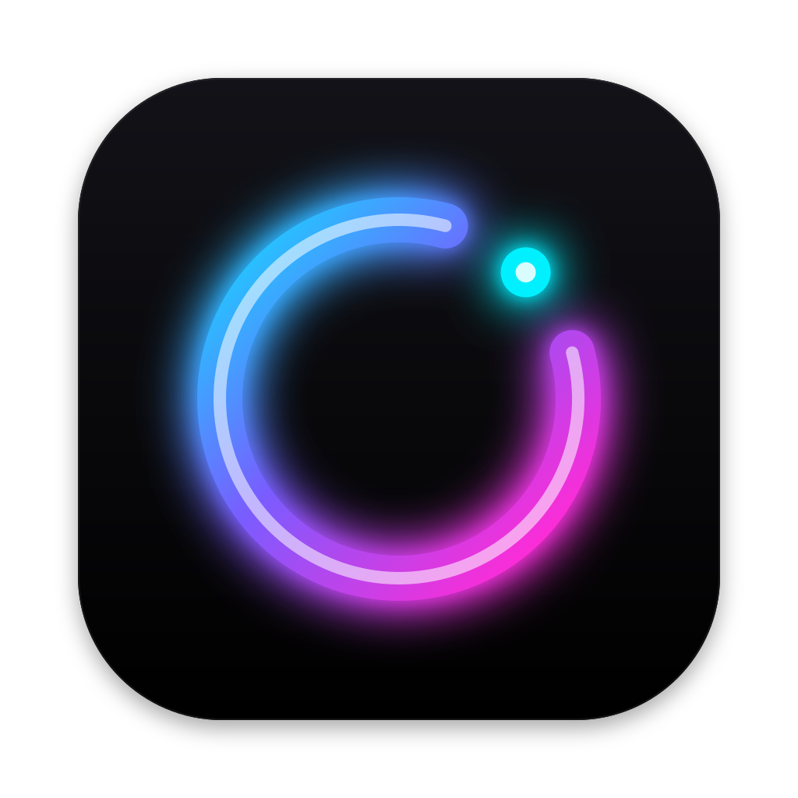

# Casting a Dream



A Mac launcher for my Dreamcast, PSP, Wii, GameCube and Famicom games. It shows them in one library and opens each game in the right emulator: [Flycast](https://github.com/flyinghead/flycast) for Dreamcast, [PPSSPP](https://github.com/hrydgard/ppsspp) for PSP, [Dolphin](https://dolphin-emu.org) for Wii and GameCube, [Mesen](https://github.com/SourMesen/Mesen2) for Famicom.

The emulators are the regular, unmodified apps. They open as normal Mac apps with their own window, Dock icon and menus, so ⌘Q, ⌘Tab and full screen work as usual. When the emulator quits, the launcher's library comes back.

## Requirements

- macOS 14 or later, Apple Silicon
- `Flycast.app`, `PPSSPP.app`, `Dolphin.app` and `Mesen.app` in `/Applications` (or `~/Applications`). The launcher finds them by bundle identifier (`com.flyinghead.Flycast`, `org.ppsspp.ppsspp`, `org.dolphin-emu.dolphin`, `ca.mesen`) and prefers the copies in an Applications folder over ones in build folders. Dolphin installs with `brew install --cask dolphin`; Mesen comes from its [GitHub releases](https://github.com/SourMesen/Mesen2/releases) (Apple Silicon build). Mesen shows a setup wizard on its first start, which has to be finished once before games launch from here.

## Library

- Games are read from `~/Games/Dreamcast`, `~/Games/PSP`, `~/Games/Wii`, `~/Games/GameCube` and `~/Games/Famicom`, one folder per game (loose files work too). The header only shows a system once it has games.
  - Dreamcast: `.chd`, `.gdi`, `.cue`, `.cdi`
  - PSP: `.iso`, `.cso`, `.chd`, `.pbp`
  - Wii: `.rvz`, `.wbfs`, `.iso`, `.wia`, `.gcz`, `.ciso`
  - GameCube: `.rvz`, `.iso`, `.gcm`, `.gcz`, `.ciso`, `.wia`
  - Famicom: `.nes`, `.fds`, `.unf`, `.unif`
- The library rescans whenever the launcher comes to the front, and with ⌘R.
- Covers: a `cover.png`/`.jpg` (or `boxart`, `folder`) in the game's folder wins. Otherwise box art is downloaded once from [libretro-thumbnails](https://thumbnails.libretro.com) by Redump/No-Intro name and cached in `~/Library/Application Support/Casting a Dream/Covers`. Misses are retried after a week.
- Play history is kept in `~/Library/Application Support/Casting a Dream/stats.json`: when each game was last played and its total play time. A session runs from the emulator opening until it quits; time the Mac spends asleep doesn't count, and quitting the launcher mid-game still records the session. Each card shows the total; games played before tracking existed show "No time tracked yet" until their next session.
- Each game has a violet button (also in its right-click menu) that opens it in [my collection](https://collection.stevan.co.rs). The collection has no per-game pages, so the link is a search for the title plus a platform filter, e.g. `?q=Sonic%20Rivals&platforms=PSP`. The title comes from the folder name without the bracketed parts. When that differs from the collection's title (a fan translation, a different romanization), put a `collection.txt` in the game's folder with the search to use instead, e.g. `Tenchi wo Kurau II`.
- **Homebrew:** my own ROM hacks get a `homebrew.txt` in their game's folder (its contents are ignored; loose files are never homebrew). Each system lists its regular games first, then the homebrew ones under a **Homebrew** header, and homebrew cards carry a "Homebrew" tag on the cover so they stand out in search results too. Arrow keys and the D-pad move between the two sections like any other row. Homebrew isn't part of the collection, so those cards have no violet button or "Open in My Collection" item, and they're left out of the collection export. Play time, covers, launching and trophies work as for any other game.

- **Collection export:** with **Library → Collection Export Folder…** pointed at the collection site's `public/data`, the launcher keeps `casting-a-dream.json` there up to date: every game except homebrew with its collection search, play time, last played date and trophies (secret ones without their name until earned). It's rewritten whenever the library, play time or trophies change, and only when something is different. The site's Casting a Dream tab lists it; publishing is a commit and push of the site.

## Playing

- Double-click a game, press Return, or press A on a controller.
- Games open in a window. **Library → Launch Games Full Screen** switches to full screen.
- While a game runs, the launcher shows a **Playing** screen with **Show Game** and **Stop Game**. Stop Game asks the emulator to quit and forces it after 5 seconds if it hasn't.
- Quitting the launcher also quits the game it started.
- Exiting the game from the emulator's own menu quits the emulator too: Flycast does this when it's started with a game, PPSSPP gets `--pause-menu-exit`, and Dolphin runs in batch mode (`-b`), which shows only the game window. Dolphin also gets `ConfirmStop=False` so quitting isn't held up by its "stop emulation?" prompt, and its first-run usage statistics question is skipped (reporting stays off). Mesen has no such mode: closing a game leaves Mesen open, so quit it (⌘Q) or use Stop Game to come back.

## Trophies

Secret trophies show as "Secret trophy" until earned. Games with a trophy set show a gold count on their card; clicking it (or **Trophies…** in the right-click menu) lists every trophy and when it was unlocked. Trophies are checked from the game's save file whenever its emulator closes, and when the launcher comes to the front (for games played outside it). New unlocks pop up in the top-right corner. Unlocks are stored in `~/Library/Application Support/Casting a Dream/trophies.json`.

A trophy set is matched to a game by the SHA-1 of its file, so renaming the folder doesn't lose it. Sets so far:

- **Destiny of an Emperor II** (English translation v1.12, SHA-1 `d02cc267e0b350b2dc84f087fbc04a778f976973`), 17 trophies: recruiting generals (specific ones and 10/30/60), first victory, party level 10/20/30, gold held (1,000/10,000/50,000) and one secret trophy. It reads Mesen's battery save (`~/Library/Application Support/Mesen2/Saves/<ROM name>.sav`): one status byte per general at `$6200 + id` (bit `0x40` set when he joins; the leader is left out of counts because a defeat sets his), experience at `$6028` and gold at `$602C` (3 bytes each, little endian), level at `$602B`. General ids come from the ROM's general table (pointer low bytes at ROM `$6DE00`, high bytes at `$6DF00`). The layout was worked out by playing the game headless in Mesen and comparing battery RAM before and after generals joined. See `Sources/CastingADream/Trophies/DestinyOfAnEmperorII.swift`.
- **Psychic Force 2012** (Europe, Redump `.cue` SHA-1 `32e751e1abe148a16a5d45587a8ff8076d7e923a`), 16 trophies: unlocking Wong, Keith, Burn and Emilio's two other forms, beating the game with Wong, Keith, Burn, 5 and all 13 characters, picking all ten starting characters, one character 100 times, and 1/10/20 hours in battle; two are secret. It reads the `PSYCHIC_2012` file from Flycast's per-game VMU (`~/Library/Application Support/Flycast/data/T-8106D-50_vmu_save_A1.bin`, falling back to the shared `vmu_save_A1.bin`), so only what the game has saved counts (it saves after endings when Auto Save is on). The game data starts at `0xE80` in the file (after the VMS header, 3 icons and the eyecatch) and is checked against its checksum byte at `+0x2E7`: battle time in frames at `+0x04`, characters beaten with at `+0x28`/`+0x2A` (one bit each), times each character was picked at `+0x2E`, unlock flags at `+0x50`–`+0x54`. The layout was worked out by disassembling `1ST_READ.BIN`; see `Sources/CastingADream/Trophies/PsychicForce2012.swift`.
- **Frame Gride** (English translation, `.cdi` SHA-1 `6f52468fe2485dfcf9e48b37144e4c3fbccd3054`), 14 trophies: battles won (1/10/50/100) and fought (200), rank 3/6/10, frame parts owned (30/all 60), squires owned (1/10/all 32) and every material held at once; one is secret. Each knight is its own `F_GRIDE.0NNN` file on Flycast's per-game VMU (`T34201M_vmu_save_A1.bin`), and a trophy counts when any knight on the card qualifies. The knight data is 0x15C bytes at `0x280` in the file (after the VMS header and one icon): parts owned at `+0x2B` (60 bytes), squires at `+0xA7` (32), materials at `+0xC7` (13), total wins and battles at `+0x130` and `+0x138`, rank at `+0x140`. The layout was worked out by disassembling `1ST_READ.BIN`; see `Sources/CastingADream/Trophies/FrameGride.swift`.
- **MotorStorm: Arctic Edge** (Europe, UCES01250, `.iso` SHA-1 `628261971367a334c95456d0c2a3cf665e459dfa`), 16 trophies: medals and golds in the Festival's 90 races (first, 10/30 golds, medals in 45, finishing / a medal / silver / gold in every race), Festival points (1,000/4,000/7,000), vehicles (20/40), all 24 track routes and all 22 drivers; one is secret. It reads `DATA.BIN` from PPSSPP's `PSP/SAVEDATA/UCES01250*` folder (`~/.config/ppsspp`), which PPSSPP encrypts like a real PSP. The launcher decrypts it with PSP savedata mode 5 (PPSSPP's sceChnnlsv cipher, reduced to the decryption it needs, in `PSPSavedata.swift`, which also handles mode 3) and the game's key, found in the decrypted `EBOOT.BIN` by testing every 16 bytes against the file hash in `PARAM.SFO`. In the profile: magic `0x21100018` at `0x00`, points at `0x18`, races finished at `0x1C`, best position per race at `0x220` (1 gold, 2 silver, 3 bronze, `0xFFFFFFFF` not raced), and count-prefixed lists of unlocked track routes (`0xD2C`), vehicles (`0xDF4`) and drivers (`0xFF8`). The layout was confirmed against six profiles from GameFAQs (700 to 9,000 points, one of them US), which decrypt with the same key. An unencrypted `DATA.BIN` (PPSSPP's "Encrypt save data" off) works too. See `Sources/CastingADream/Trophies/MotorStormArcticEdge.swift`.

- **Sonic Rivals** (Europe, ULES00622, `.iso` SHA-1 `b46d1b2456129ed25ce66ca93d295c4f505e0283`), 10 trophies: clearing a story stage, finishing Sonic's, Shadow's, Knuckles' and Silver's stories (and all four), and collecting 10/75/120/150 cards; one is secret. It reads `GAMEDATA.BIN` from PPSSPP's `PSP/SAVEDATA/ULES00622RVSAVEDATA*` folder and decrypts it with the game's key, the string `RIVALSZ` padded with zeros (found by trying every short string in the decrypted `EBOOT.BIN` against `PARAM.SFO`'s file hash), in PSP savedata mode 5 or 3. In the profile: 150 cards of 12 bytes from `0x4ED8` (collected when the first byte isn't 0, as the game counts them for the save's "Card Collection" line) and one u32 per character at `0x5BC4` with a bit per story stage (17 for 100%). Checked against six GameFAQs saves (89 to 150 cards, US and EU, both encryption modes). See `Sources/CastingADream/Trophies/SonicRivals.swift`.

- **Medal of Honor: Heroes 2** (Europe, RM2P69, `.rvz` SHA-1 `8dc140d9c4fc1bebdd1cb0380abbe697fb8843dd`), 25 trophies: the game's own 23 awards (from `data/locks.xml` on the disc, with their in-game names), 10 awards, and all of them (secret). Wii saves sit unencrypted in Dolphin's NAND (`~/Library/Application Support/Dolphin/Wii/title/00010000/<game ID in hex>/data`); each profile is a file there (`001`, ...). `game.dol`'s award manager sets byte `0x3C4A + id` of the profile, which is saved from offset `0x84`, so award flags are at `0x3CCE + id`. Checked on two US saves from GameFAQs. See `Sources/CastingADream/Trophies/MedalOfHonorHeroes2.swift`.
- **Animal Crossing: City Folk** (USA, RUUE01, `.rvz` SHA-1 `2fba8c6564d9c90da968babb6deeafb676b2f379`), 13 trophies: museum donations (any, 100, 150; fish and insects 10 and all 64; fossils 10/25; paintings 5) and Bells on hand plus savings (100,000/1,000,000/10,000,000, the last secret). It reads the town file (0x40F340 bytes, `RVFOREST.DAT`) from Dolphin's NAND: players every 0x86C0 bytes with Bells at `+0x1154` and savings at `+0x115C`, museum donors as nibbles from `0x7352A`. These offsets come from the ACToolkit and ACSE save editors, which agree; no unmodified City Folk save was available to check them against. See `Sources/CastingADream/Trophies/AnimalCrossingCityFolk.swift`.

To add a game, implement `TrophySet` (how to find the save, which trophies the bytes earn) and add it to `TrophySets.all`.

## Controls

| | Keyboard | Controller |
|---|---|---|
| Move | Arrow keys | D-pad / left stick |
| Play | Return or double-click | A (✕ on PlayStation) |
| Switch system | Click the pills | L1 / R1 |
| Clear search / selection | Esc | B (○) |
| Search | ⌘F | — |

## Building

```sh
scripts/package.sh                       # builds build/Casting a Dream.app
mv "build/Casting a Dream.app" /Applications/
```

To change the icon, edit `Resources/icon/casting-a-dream.svg` and run `scripts/render-icon.sh` (needs `brew install librsvg`).

### Building the emulators from source

Both build on Apple Silicon from their upstream repositories:

- **Flycast:** `brew install cmake ninja molten-vk libomp`, `xcodebuild -downloadComponent MetalToolchain`, then
  `cmake -B build -G Xcode -DCMAKE_BUILD_TYPE=Release -DCMAKE_OSX_ARCHITECTURES=arm64 -DCMAKE_INSTALL_PREFIX=artifact -DUSE_BREAKPAD=OFF -DMOLTENVK_DYLIB=/opt/homebrew/opt/molten-vk/lib/libMoltenVK.dylib`
  and `cmake --build build --config Release --target install`. The app is `artifact/bin/Flycast.app`.
- **PPSSPP:** `brew install sdl3 sdl3_ttf`, then `./b.sh --release --arm64`. The app is `build/PPSSPPSDL.app`; copy it to `/Applications/PPSSPP.app` and re-sign it with `codesign --force --deep --sign - /Applications/PPSSPP.app`.
